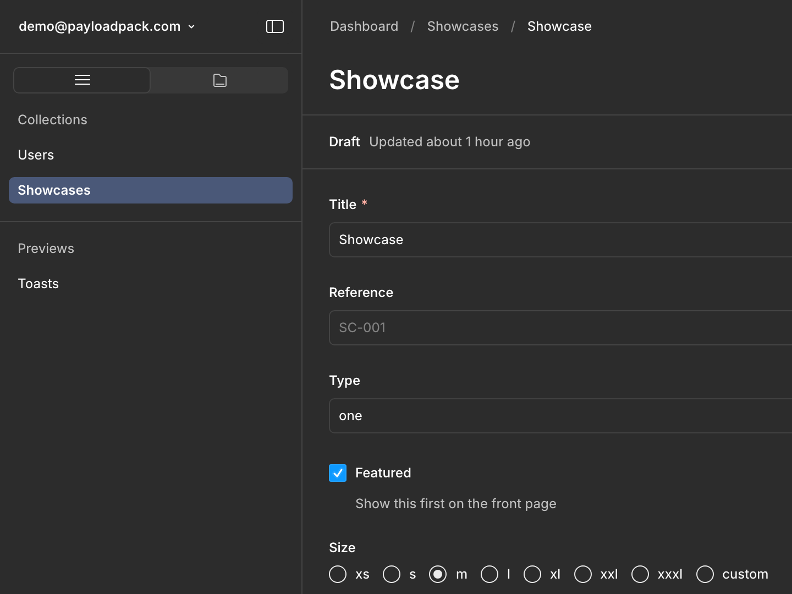
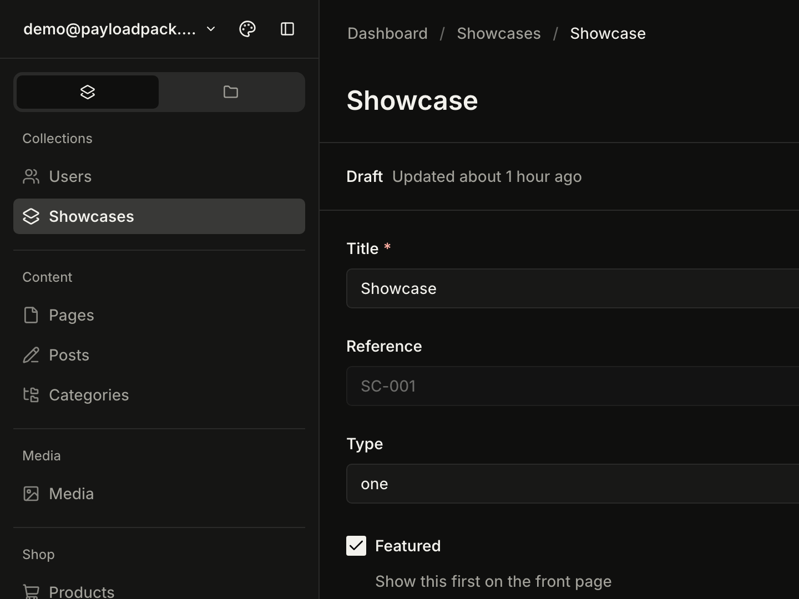
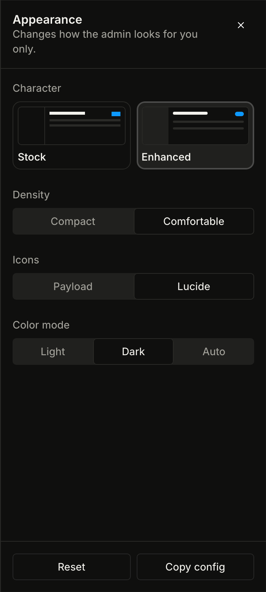
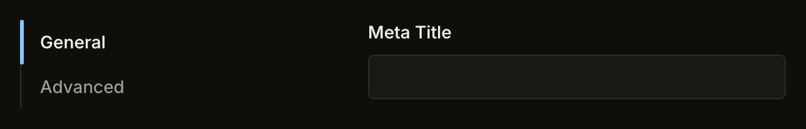
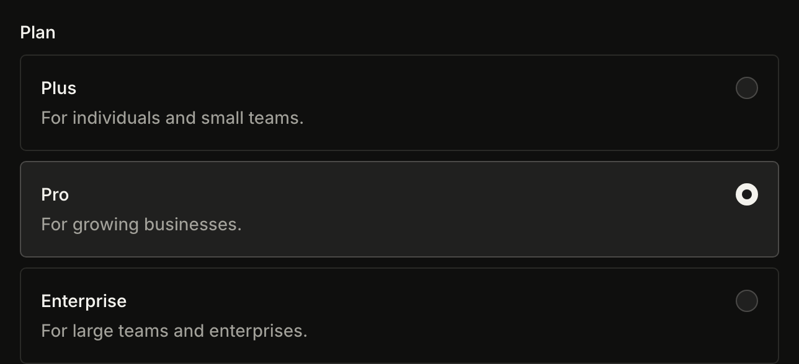
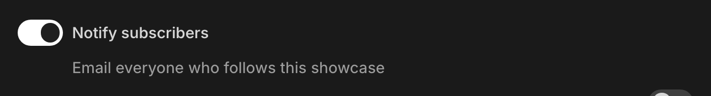

<h1 align="center">@payloadpack/theme</h1>

<p align="center">A warmer, roomier admin theme for Payload 4.</p>

<p align="center">
  <a href="https://www.npmjs.com/package/@payloadpack/theme"></a>
  <a href="https://github.com/payloadpack/theme/actions/workflows/ci.yml"></a>
  <a href="https://payloadcms.com"></a>
  <a href="https://github.com/payloadpack/theme/blob/main/packages/theme/LICENSE"></a>
</p>

<table>
  <tr>
    <th width="50%">Stock Payload</th>
    <th width="50%">With @payloadpack/theme</th>
  </tr>
  <tr>
    <td>
      <picture>
        <source media="(prefers-color-scheme: light)" srcset="https://raw.githubusercontent.com/payloadpack/theme/main/.github/assets/compare-stock-light.png">
        
      </picture>
    </td>
    <td>
      <picture>
        <source media="(prefers-color-scheme: light)" srcset="https://raw.githubusercontent.com/payloadpack/theme/main/.github/assets/compare-themed-light.png">
        
      </picture>
    </td>
  </tr>
</table>

Each editor picks how their admin panel looks from the Appearance panel in the header: a character for the layout and a palette for the colors. The default is the Enhanced character, with a roomier density and Lucide icons, on the Warm palette. Stock on the Payload palette is plain Payload. Setups are rendered on the server, so pages never flash.

## Install

```sh
bun add @payloadpack/theme
```

```ts
import { themePlugin } from '@payloadpack/theme'

export default buildConfig({
  plugins: [themePlugin()]
})
```

Then regenerate the import map:

```sh
payload generate:importmap
```

## Appearance

Click the Appearance button in the header to open the Appearance panel:

<p>
  <picture>
    <source media="(prefers-color-scheme: light)" srcset="https://raw.githubusercontent.com/payloadpack/theme/main/.github/assets/appearance-light.png">
    
  </picture>
</p>

The panel opens as a sheet on the right and fills the screen on phones. Every change applies at once, so there is no Save button. Escape or a click outside closes it.

- **Character** is how the whole admin panel is laid out and behaves. Stock is Payload's own layout and has no options. Enhanced touches up Payload's own design without changing its structure, and is the default. Studio puts each view in a soft card on a field. The section is hidden when only one character is allowed.
- **Options** belong to a character. Enhanced has Corners, Density, Icons, Motion and Collapsed nav. Studio has the same five and adds Typeface, Frame and Content width. Each character keeps its own values, so switching to Stock and back keeps them.
- **Palette** is the colors, in a light and a dark version. Payload is Payload's own colors. Warm, the default, is Payload's light colors and a warm near-black dark mode. Studio tints the field and the nav with its accent, copper by default. Every palette works with every character. The section is hidden when only one palette is allowed.
- **New palette** turns the current palette into your own: a background, surface and text color for light and for dark mode, and an accent for primary buttons, links and selected items. Each color applies as you pick it, and the rest of the colors are mixed from these. **Copy as CSS** copies your palette as the CSS block the theme renders for it. Switching to another palette keeps yours for later.
- **Color mode** is Payload's own light and dark setting, the same one as Admin Theme on the account page. It is hidden when `admin.theme` is `'light'` or `'dark'`.
- **Reset** returns to the defaults in your plugin config. It leaves the color mode alone.
- **Copy setup** copies your character, its options and your palette, with its colors when it is your own, as JSON. **Paste setup** applies the setup on your clipboard, for example one another editor copied, and says so when there isn't one. The JSON is also valid plugin config.

| Option        | Values                 | Enhanced default | Studio default |
| ------------- | ---------------------- | ---------------- | -------------- |
| Corners       | None, S, M, L, Round   | M                | L              |
| Typeface      | Payload, Geist, System |                  | Geist          |
| Frame         | Boxed, Flat            |                  | Boxed          |
| Content width | Centered, Full         |                  | Centered       |
| Density       | Compact, Comfortable   | Comfortable      | Comfortable    |
| Icons         | Payload, Lucide        | Lucide           | Lucide         |
| Motion        | Off, On                | On               | On             |
| Collapsed nav | Icons, Hidden          | Icons            | Icons          |

- **Enhanced** draws a 2px focus ring, rounds popups and toasts a little more, lifts the date picker and toasts like menus, and insets the sidebar tabs.
- **Studio** keeps the nav on the field, puts the collapse button at its top left and moves the user menu to the bottom of it.
- Every palette except Payload's draws the focus ring in the text color, gives all fields one border color, fades disabled and read-only fields to half their colors, and softens checkbox and radio rings.
- **Warm** gives dark mode a warm near-black palette and swaps Payload's blue selection for neutral greys. It fills checked checkboxes and selected radios with the text color instead of the accent.
- **Studio**, the palette, mixes a faint share of the accent into a warm off-white field and nav, with white cards and lines tinted the same way. Dark mode mixes it into near-black. Selected items take a soft fill of the accent.
- **Corners** scales Payload's own corner sizes. M keeps them as they are, None squares every corner, S and L make them smaller or larger, and Round is L with pill-shaped buttons.
- **Geist** loads [Geist](https://vercel.com/font) with `next/font`, the way Payload loads Inter, and only downloads it when an editor uses it. **Payload** keeps Inter. **System** uses the operating system's font.
- **Boxed** puts each view in a soft card with a border and rounded corners. **Flat** drops the card and keeps the nav's border.
- **Centered** caps every view at 880px and centers it. **Full** lets it fill the width.
- **Comfortable** sets 14px body text, 36px fields and buttons, 32px menu items and 18px checkboxes and radios, gives dialogs more room, and fixes Payload components that hard-code their sizes.
- **Lucide** replaces Payload's icons with [Lucide](https://lucide.dev) and adds icons to the nav and the document menu. The icons are bundled, so nothing loads from a CDN.
- **Motion** brings back the transitions Payload 3 had: drawers fade and slide in, tooltips fade, and fields, buttons and cards ease between states. Popups, select menus and the date picker fade in too. It stays off when the operating system asks for reduced motion.
- **Icons** as the collapsed nav turns the nav's collapse button into a 64px rail of Lucide icons, with each label as a tooltip. The rail is kept per browser in a `<cookiePrefix>-nav-rail` cookie, so Reset leaves it alone. Below 768px the nav is Payload's own drawer. **Hidden** keeps Payload's own collapse.

A signed-in editor's setup is saved in Payload's own preferences, so it follows them to every browser. It is mirrored in one cookie, `<cookiePrefix>-appearance`, next to Payload's own theme cookie, which the server uses on the login page and until a setup is saved. The server renders the setup, so pages never flash.

The panel's labels ship in English. To translate them, or rename one, set the `payloadpack` keys from [translations.ts](https://github.com/payloadpack/theme/blob/main/packages/theme/src/translations.ts) in your own `i18n.translations`, which win over the plugin's. Character and palette names stay as they are.

```ts
export default buildConfig({
  i18n: {
    translations: {
      de: { payloadpack: { appearance: 'Darstellung', colorMode: 'Farbmodus' } }
    }
  }
})
```

## Configuration

```ts
themePlugin({
  character: 'enhanced',
  characters: ['stock', 'enhanced', 'studio'],
  options: { enhanced: { density: 'compact', icons: 'lucide' }, studio: { frame: 'flat' } },
  palette: 'warm',
  palettes: ['payload', 'warm', 'studio'],
  accent: { warm: '#1d4ed8' },
  panel: ({ user }) => user?.role === 'admin',
  codeEditorFontSize: 13
})
```

| Key                  | Default                                                      | Description                                                                                                                                                                                                                                                          |
| -------------------- | ------------------------------------------------------------ | -------------------------------------------------------------------------------------------------------------------------------------------------------------------------------------------------------------------------------------------------------------------- |
| `character`          | `'enhanced'`                                                 | The character everyone starts with. It must be one of `characters`.                                                                                                                                                                                                  |
| `characters`         | `['stock', 'enhanced', 'studio']`                            | The characters editors may pick. An editor whose character is no longer allowed gets `character`.                                                                                                                                                                    |
| `options`            | Each character's defaults from the option table              | Option values per character, which editors start from and Reset returns to. Each character takes only its own options, so a typo is a type error. Stock has no options and no key.                                                                                   |
| `palette`            | `'warm'`                                                     | The palette everyone starts with. It must be one of `palettes`.                                                                                                                                                                                                      |
| `palettes`           | `['payload', 'warm', 'studio']`                              | The palettes editors may pick. An editor whose palette is no longer allowed gets `palette`.                                                                                                                                                                          |
| `accent`             | `{ payload: '#0d99ff', warm: '#0d99ff', studio: '#c2410c' }` | The accent per palette, as `#rrggbb`.                                                                                                                                                                                 |
| `panel`              | `true`                                                       | Who gets the Appearance panel: `true`, `false` or `({ user }) => boolean`. When it resolves to `false`, the editor gets no Appearance button and their saved setup is ignored. Signed-out views have no user, so there the cookie applies unless `panel` is `false`. |
| `codeEditorFontSize` | `13`                                                         | Font size for code editors in Comfortable density. Payload's default is 11. Fields that set `admin.editorOptions.fontSize` keep their own size. `false` turns it off.                                                                                                |

A setup from Copy setup has the same shape, so pasting it into `themePlugin()` makes it everyone's default:

```ts
themePlugin({
  character: 'stock',
  palette: 'payload'
})
```

A setup on an editor's own palette also carries that palette's colors, which the plugin config does not take.

## Vertical tabs

<p>
  <picture>
    <source media="(prefers-color-scheme: light)" srcset="https://raw.githubusercontent.com/payloadpack/theme/main/.github/assets/vertical-tabs-light.png">
    
  </picture>
</p>

Give a tabs field the `VERTICAL_TABS` class to list its tabs in a column beside the fields:

```ts
import { VERTICAL_TABS } from '@payloadpack/theme'

const field = {
  type: 'tabs',
  admin: { className: VERTICAL_TABS },
  tabs: [
    { label: 'General', fields: [] },
    { label: 'Advanced', fields: [] }
  ]
}
```

From 768px wide the tabs stack in a 270px column on the left. Narrower screens keep Payload's horizontal tabs. The layout applies whatever each person picks in Appearance. Payload's tab list moves between tabs with the Left and Right arrow keys, and that doesn't change.

## Radio cards

<p>
  <picture>
    <source media="(prefers-color-scheme: light)" srcset="https://raw.githubusercontent.com/payloadpack/theme/main/.github/assets/radio-cards-light.png">
    
  </picture>
</p>

Give a radio field the `RADIO_CARDS` class to show its options as stacked cards with the radio on the right:

```ts
import { RADIO_CARDS } from '@payloadpack/theme'

const field = {
  name: 'plan',
  type: 'radio',
  admin: { className: RADIO_CARDS },
  options: ['plus', 'pro', 'enterprise']
}
```

A label can also be JSX. Its first element is the title and any element after it is shown as a muted description:

```tsx
{ value: 'plus', label: <><strong>Plus</strong><span>For individuals and small teams.</span></> }
```

## Switch

<p>
  <picture>
    <source media="(prefers-color-scheme: light)" srcset="https://raw.githubusercontent.com/payloadpack/theme/main/.github/assets/switch-light.png">
    
  </picture>
</p>

Give a checkbox field the `SWITCH` class to show it as a switch:

```ts
import { SWITCH } from '@payloadpack/theme'

const field = {
  name: 'notify',
  type: 'checkbox',
  admin: { className: SWITCH }
}
```

It is still Payload's checkbox: it saves with the form, and screen readers announce it as a checkbox. Its size and thumb are set in [Customize](#customize).

## Nav icons

With Icons set to Lucide, and always in the rail, every collection and global in the nav gets an icon. Common names get a matching one automatically: a slug containing `page`, `post`, `media`, `user`, `categor`, `product`, `order`, `form`, `tag`, `event` or [more than 30 other words](https://github.com/payloadpack/theme/blob/main/packages/theme/src/options/nav-icons.css) is recognized. Anything else gets a generic icon.

To choose the icon for your own collection, set `--payloadpack-icon` on its nav link in your admin stylesheet, for example `src/app/(payload)/custom.css`. Nav links have the id `nav-<slug>` for collections and `nav-global-<slug>` for globals:

```css
#nav-recipes {
  --payloadpack-icon: url('/icons/chef-hat.svg');
}
```

Any single-color SVG works. It is used as a mask, so it takes the nav's text color. To use a Lucide icon, copy its SVG from [lucide.dev](https://lucide.dev) into `public/icons/`.

## Customize

The theme's CSS sits in `@layer payload`, so your own `custom.css` overrides it without specificity fights.

Each toolbar sizes its buttons from its own token. All but the menu items and sidebar tabs default to Payload's `--button-height`:

| Token                                       | Controls                                 |
| ------------------------------------------- | ---------------------------------------- |
| `--payloadpack-doc-header-button-height`    | Title bar with Edit, Versions and API    |
| `--payloadpack-doc-controls-button-height`  | Status and actions bar of a document     |
| `--payloadpack-list-header-button-height`   | List title bar and its selection bar     |
| `--payloadpack-list-controls-button-height` | List toolbar: Filters, Group by, Columns |
| `--payloadpack-row-button-height`           | Array and block rows                     |
| `--payloadpack-menu-item-height`            | Popup menu items, 32px                   |
| `--payloadpack-sidebar-tabs-height`         | Collections and Folders tabs, 38px       |

Checkboxes and radios share their size and, on every palette but Payload's, their colors:

| Token                                 | Controls                                   |
| ------------------------------------- | ------------------------------------------ |
| `--payloadpack-toggle-size`           | Box and circle size in Comfortable density |
| `--payloadpack-toggle-bg`             | Unchecked background                       |
| `--payloadpack-toggle-bg-hover`       | Unchecked background on hover              |
| `--payloadpack-toggle-border`         | Unchecked border                           |
| `--payloadpack-toggle-checked-bg`     | Checked fill                               |
| `--payloadpack-toggle-checked-border` | Checked border                             |
| `--payloadpack-toggle-mark`           | Tick and dot                               |
| `--payloadpack-toggle-ring`           | Keyboard focus ring                        |

```css
html {
  --payloadpack-row-button-height: 2.5rem;
}
```

Switches take their colors from the toggle tokens and their shape from these. Set them on `.payloadpack-switch`:

| Token                         | Controls                                             |
| ----------------------------- | ---------------------------------------------------- |
| `--payloadpack-switch-size`   | Height, 1.5rem. The width follows                    |
| `--payloadpack-switch-gap`    | Space around the thumb as a share of the height, 0.1 |
| `--payloadpack-switch-radius` | Thumb corners, fully round. The track follows        |
| `--payloadpack-switch-thumb`  | Thumb color while off                                |

```css
.payloadpack-switch {
  --payloadpack-switch-size: 1.5rem;
  --payloadpack-switch-radius: 4px;
}
```

## Requirements

- Payload `4.0.0-beta.6` or later
- Next.js `16.4.2` or later
- React 19

## License

[MIT](https://github.com/payloadpack/theme/blob/main/packages/theme/LICENSE)
