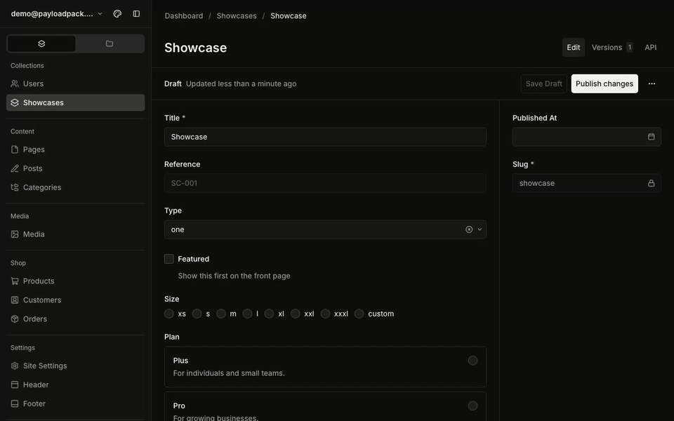

<p align="center">
  <picture>
    <source media="(prefers-color-scheme: light)" srcset="https://raw.githubusercontent.com/payloadpack/theme/main/.github/assets/icons/logo-light.svg">
    
  </picture>
</p>

<h1 align="center">@payloadpack/theme</h1>

<p align="center">A warmer, roomier admin for Payload 4.<br>Every editor picks their own style and palette. You configure nothing.</p>

<p align="center">
  <a href="https://www.npmjs.com/package/@payloadpack/theme"></a>
  <a href="https://github.com/payloadpack/theme/actions/workflows/ci.yml"></a>
  <a href="https://payloadcms.com"></a>
  <a href="https://github.com/payloadpack/theme/blob/main/packages/theme/LICENSE"></a>
</p>

<p align="center">
  <a href="https://theme.payloadpack.com/"><b>Documentation</b></a> ·
  <a href="https://theme.payloadpack.com/installation/">Installation</a> ·
  <a href="https://github.com/payloadpack/theme/blob/main/packages/theme/CHANGELOG.md">Changelog</a>
</p>

<picture>
  <source media="(prefers-color-scheme: light)" srcset="https://raw.githubusercontent.com/payloadpack/theme/main/.github/assets/panel-tour-light.gif">
  
</picture>

## What you get

- 📐 **Three styles.** Payload's own, Enhanced and Studio. Fine-tune corners, typeface, density, icons, motion and nav.
- 🎨 **Palettes and custom colors.** Payload, Neutral, Warm and Soft in light and dark. Editors mix their own, and you can ship yours.
- 👤 **A setup per editor.** Saved in Payload's preferences and rendered on the server. It follows every editor, and pages never flash.
- 🎛️ **Field layouts.** Vertical tabs, radio cards and switches, each one `className` away.
- ✨ **Icons everywhere.** Lucide icons in the nav and document menu, matched to your collections automatically.
- 🖌️ **One token sheet.** Restyle the whole admin from a short list of CSS custom properties.

## Install

```sh
bun add @payloadpack/theme
```

```ts
import { themePlugin } from '@payloadpack/theme'

export default buildConfig({
  plugins: [themePlugin()]
})
```

```sh
payload generate:importmap
```

That's it. Every editor now has an Appearance button in the nav.

## Before and after

<table>
  <tr>
    <th width="50%">Plain Payload</th>
    <th width="50%">With @payloadpack/theme</th>
  </tr>
  <tr>
    <td>
      <picture>
        <source media="(prefers-color-scheme: light)" srcset="https://raw.githubusercontent.com/payloadpack/theme/main/.github/assets/compare-payload-light.png">
        
      </picture>
    </td>
    <td>
      <picture>
        <source media="(prefers-color-scheme: light)" srcset="https://raw.githubusercontent.com/payloadpack/theme/main/.github/assets/compare-themed-light.png">
        
      </picture>
    </td>
  </tr>
</table>

## Field layouts

<table>
  <tr>
    <th width="33%">Vertical tabs</th>
    <th width="33%">Radio cards</th>
    <th width="33%">Switch</th>
  </tr>
  <tr>
    <td>
      <picture>
        <source media="(prefers-color-scheme: light)" srcset="https://raw.githubusercontent.com/payloadpack/theme/main/.github/assets/vertical-tabs-light.png">
        
      </picture>
    </td>
    <td>
      <picture>
        <source media="(prefers-color-scheme: light)" srcset="https://raw.githubusercontent.com/payloadpack/theme/main/.github/assets/radio-cards-light.png">
        
      </picture>
    </td>
    <td>
      <picture>
        <source media="(prefers-color-scheme: light)" srcset="https://raw.githubusercontent.com/payloadpack/theme/main/.github/assets/switch-light.png">
        
      </picture>
    </td>
  </tr>
  <tr>
    <td><code>className: VERTICAL_TABS</code></td>
    <td><code>className: RADIO_CARDS</code></td>
    <td><code>className: SWITCH</code> or <code>SWITCH_END</code></td>
  </tr>
</table>

## Configure

Every key is optional.

```ts
themePlugin({
  character: 'studio',
  palette: 'warm',
  panel: ({ user }) => user?.role === 'admin'
})
```

| Key                  | What it sets                                 |
| -------------------- | -------------------------------------------- |
| `character`          | The style everyone starts with               |
| `characters`         | The styles editors may pick                  |
| `options`            | Each style's starting options                |
| `palette`            | The palette everyone starts with             |
| `palettes`           | The palettes editors may pick, yours too     |
| `panel`              | Who gets the Appearance panel                |
| `codeEditorFontSize` | Code editor font size in Comfortable density |

Defaults and details are in the [configuration docs](https://theme.payloadpack.com/configuration/).

## Customize

Override any token in your admin stylesheet. The theme's CSS sits in `@layer payload`, so yours always wins:

```css
html {
  --payloadpack-radius-card: 1rem;
  --payloadpack-motion-panel-duration: 300ms;
}
```

Every token, and how to ship your own palette, is in the [customize docs](https://theme.payloadpack.com/customize/).

## Requirements

Payload 4.0.0-beta.7+, Next.js 16.4.2+ and React 19, in Safari 17, Chrome 114 or Firefox 128 and later.

## License

Use it in any project, including client work you charge for and products you sell. What you can't do is offer the theme, or a copy or fork of it, to others as a competing admin theme, paid or free. The terms are the [PolyForm Perimeter License 1.0.1](https://github.com/payloadpack/theme/blob/main/packages/theme/LICENSE).

<p align="center">
  <a href="https://theme.payloadpack.com/">Documentation</a> ·
  <a href="https://github.com/payloadpack/theme/blob/main/CONTRIBUTING.md">Contributing</a> ·
  <a href="https://github.com/payloadpack/theme/blob/main/packages/theme/LICENSE">PolyForm Perimeter License</a>
</p>
