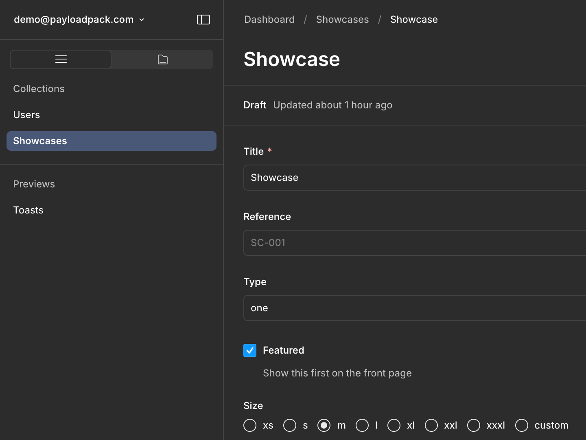
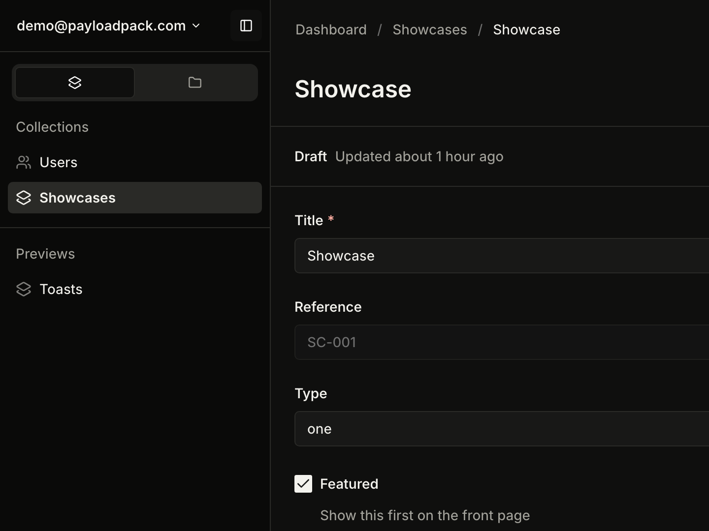

<h1 align="center">@payloadpack/theme</h1>

<p align="center">A warmer, roomier admin theme for Payload 4.</p>

<p align="center">
  <a href="https://www.npmjs.com/package/@payloadpack/theme"></a>
  <a href="https://github.com/payloadpack/theme/actions/workflows/ci.yml"></a>
  <a href="https://payloadcms.com"></a>
  <a href="packages/theme/LICENSE"></a>
</p>

<table>
  <tr>
    <th width="50%">Stock Payload</th>
    <th width="50%">With @payloadpack/theme</th>
  </tr>
  <tr>
    <td>
      <picture>
        <source media="(prefers-color-scheme: light)" srcset=".github/assets/compare-stock-light.png">
        
      </picture>
    </td>
    <td>
      <picture>
        <source media="(prefers-color-scheme: light)" srcset=".github/assets/compare-themed-light.png">
        
      </picture>
    </td>
  </tr>
</table>

<p align="center"><a href="packages/theme#readme"><b>Install and usage →</b></a></p>

## Repository

| Path             | What                                                  |
| ---------------- | ----------------------------------------------------- |
| `packages/theme` | The published package                                 |
| `apps/demo`      | A Payload 4 app that uses the package, plus e2e tests |

## Develop

```sh
bun install
cp apps/demo/.env.example apps/demo/.env
bun run dev
```

The demo runs on http://localhost:3020/admin and seeds itself on first start. Log in with `demo@payloadpack.com` / `demo`.

The demo imports the built package, so rebuild after changing it:

```sh
cd packages/theme && bun run build
```

## Test

| Command                             | What it checks                                                                                    |
| ----------------------------------- | ------------------------------------------------------------------------------------------------- |
| `cd packages/theme && bun run test` | Every Payload token, class, icon and hard-coded size the theme depends on still exists in Payload |
| `cd apps/demo && bun run test:e2e`  | The rendered sizes, colors and icons in a real browser                                            |

Run both after bumping Payload. A failing contract test names the token, class or hard-coded value that changed.

## Screenshots

The README images in `.github/assets` come from the demo. When main changes the demo, the theme or `bun.lock`, the Screenshots workflow renders them on macOS and opens a pull request for any image that looks different. The same script runs locally and rewrites every image that renders differently on your machine, so leave committing them to the workflow:

```sh
cd apps/demo && bun run screenshots
```

## Release

Merge pull requests with a [Conventional Commits](https://www.conventionalcommits.org) title. Release Please opens a release pull request; merging it publishes the package to npm with provenance.

The release and screenshots workflows need the repository secret `PAYLOADPACK_RELEASE_BOT_TOKEN`. The release workflow publishes to npm through Trusted Publishing, so no npm token is stored.
