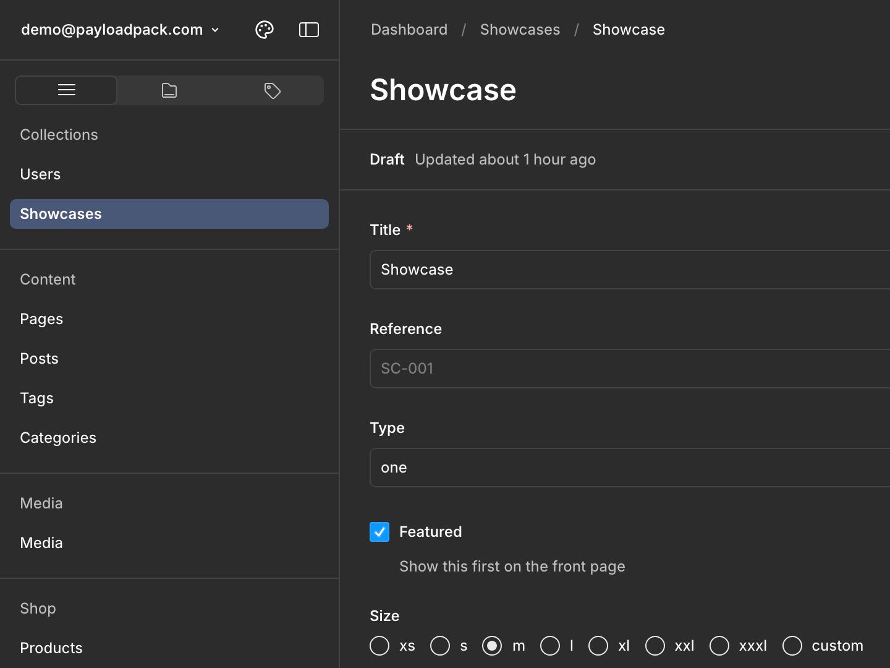

<h1 align="center">@payloadpack/theme</h1>

<p align="center">A warmer, roomier admin theme for Payload 4.</p>

<p align="center">
  <a href="https://www.npmjs.com/package/@payloadpack/theme"></a>
  <a href="https://github.com/payloadpack/theme/actions/workflows/ci.yml"></a>
  <a href="https://payloadcms.com"></a>
  <a href="https://github.com/payloadpack/theme/blob/main/packages/theme/LICENSE"></a>
</p>

<table>
  <tr>
    <th width="50%">Plain Payload</th>
    <th width="50%">With @payloadpack/theme</th>
  </tr>
  <tr>
    <td>
      <picture>
        <source media="(prefers-color-scheme: light)" srcset="https://raw.githubusercontent.com/payloadpack/theme/main/.github/assets/compare-payload-light.png">
        
      </picture>
    </td>
    <td>
      <picture>
        <source media="(prefers-color-scheme: light)" srcset="https://raw.githubusercontent.com/payloadpack/theme/main/.github/assets/compare-themed-light.png">
        
      </picture>
    </td>
  </tr>
</table>

Each editor picks how their admin panel looks from the Appearance panel: a style for the layout and a palette for the colors. The default is the Enhanced style, with a roomier density and Lucide icons, on the Neutral palette. The Payload style on the Payload palette is plain Payload. Setups are rendered on the server, so pages never flash.

## Install

```sh
bun add @payloadpack/theme
```

```ts
import { themePlugin } from '@payloadpack/theme'

export default buildConfig({
  plugins: [themePlugin()]
})
```

List `themePlugin()` after any plugin that adds collections, so their checkbox columns get the theme's list cell too. Payload's own internal collections, such as `payload-jobs`, keep Payload's cell.

Then regenerate the import map:

```sh
payload generate:importmap
```

Run it again after every upgrade. 0.3 removes the `AppearanceOptions` component that 0.2 registered, so an old import map fails `next build`. 0.3 also drops the `--payloadpack-sidebar-tabs-height` token: the sidebar tabs now sit inside their track and follow the field height.

## Appearance

Click the Appearance button, beside the collapse button at the top of the nav, or in the header under the Payload style and on phones, to open the Appearance panel:

<p>
  <picture>
    <source media="(prefers-color-scheme: light)" srcset="https://raw.githubusercontent.com/payloadpack/theme/main/.github/assets/appearance-light.png">
    
  </picture>
</p>

The panel opens as a sheet on the right, and from the bottom on phones. Every change applies at once, so there is no Save button. Escape or a click outside closes it.

- **Theme** is Payload's own light and dark setting, the same one as Admin Theme on the account page. It is hidden when `admin.theme` is `'light'` or `'dark'`.
- **Palette** is the colors, in a light and a dark version. Payload is Payload's own colors. Neutral, the default, puts white cards on a soft grey field in light mode and goes near-black in dark mode. Warm tints the field and the nav with copper and fills what you press with it. Soft is quiet greys with a near-black primary and a blue accent, its menus a step lighter than the page in dark mode. Every palette works with every style. The section is hidden when only one palette is allowed.
- **Custom**, the dashed tile after the palettes, turns the current palette into your own: a background, surface, text and primary color for light and for dark mode, and one accent for both. Primary fills what you press and what is picked: primary buttons, checked checkboxes, radios and switches, a picked date and the focus ring. The accent marks links and statuses. Each color applies as you pick it, and the rest of the colors are mixed from these. **Copy as CSS** copies your palette as the CSS block the theme renders for it. Picking another palette keeps yours for later, and **Remove custom colors** deletes it.
- **Style** is how the whole admin is laid out and behaves. Payload is Payload's own layout and has nothing to fine-tune. Enhanced touches up Payload's own design without changing its structure, and is the default. Studio puts each view in a soft card on a field. The style cards are hidden when only one style is allowed.
- **Fine-tune** holds the options of the style you picked. Enhanced and Studio have the same seven, with different starting values. Density, Motion and Nav are yours, so they stay put when you switch style. Corners, Typeface, Icons and Frame belong to each style, so switching to Payload and back keeps them. The heading counts what you changed. **Reset** puts every field back to the style's starting values, and **Undo** brings your changes back for a few seconds.
- **Share setup** copies your style, its options and your palette, with its colors when it is your own, as JSON, or pastes a setup another editor copied. The footer says when it worked, when the clipboard holds no setup, and when the browser blocks the clipboard. A setup with its own colors replaces yours. The JSON is also valid plugin config.

| Option   | Values                           | Enhanced default | Studio default |
| -------- | -------------------------------- | ---------------- | -------------- |
| Corners  | None, Small, Medium, Large, Full | Medium           | Large          |
| Typeface | Inter, Geist, System             | Inter            | Geist          |
| Frame    | Boxed, Flat                      | Flat             | Boxed          |
| Density  | Compact, Comfortable             | Comfortable      | Comfortable    |
| Icons    | Payload, Lucide                  | Lucide           | Lucide         |
| Motion   | Off, Auto                        | Auto             | Auto           |
| Nav      | Rail, Hidden                     | Rail             | Rail           |

- **Enhanced** and **Studio** both draw a 2px focus ring, widen the nav to 288px and line its buttons, tabs and items up 12px from its edges, inset the sidebar tabs and the dividers between nav groups, move each nav group's chevron to the end of its row, and show checkbox columns in lists as a check or a muted x. The plugin gives every checkbox field without its own list `Cell` a cell that wraps Payload's own, so the first column still links to the document and still picks it in a relationship drawer, and screen readers still hear Payload's text. When `characters` is only `['payload']`, checkbox fields keep Payload's cell.
- **Enhanced** lifts the date picker and toasts like menus.
- **Studio** keeps the nav on the field, puts the collapse button at its top left, and moves the user menu to the bottom of it.
- Every palette except Payload's draws the focus ring in the primary color, gives all fields one border color, fades disabled and read-only fields to half their colors, softens checkbox and radio rings, lifts the selected nav link on a white pill with a shadow in light mode, or fills it flat where the palette sets a selected color and no selected shadow, mutes the other nav links, fills selected rows and options, open menus and hovered or open menu items in grey instead of the accent, fills every solid selection, such as a picked date, with the primary and draws selection borders in it, fills a hovered nav group heading like a link, sets the sidebar tabs on a grey track with the active tab in the surface color, gives the rich text slash menu a slim scrollbar that stays clear of its rounded corners in Chrome and Safari, and draws menus, select lists and toasts in the page's mode, so the menus Payload keeps dark in light mode turn light.
- **Neutral** puts white cards and inputs on a soft `#f6f6f6` grey with `#171717` text and a `#0a0a0a` primary in light mode, gives dark mode a near-black palette with its text color as primary, and takes its text color as accent, so selections, links and marks are greys and nothing is blue.
- **Warm** mixes a faint share of its copper accent into an off-white field and nav, with white cards and lines tinted the same way, and takes the copper as its primary too. Dark mode mixes it into near-black.
- **Soft** puts white cards on a `#fafafa` field with `#333333` text, faint `#ebebeb` lines, a `#1f1f1f` primary and a `#0078e7` blue accent in light mode. Dark mode sets `#1a1a1a` views beside a `#1f1f1f` nav, with menus the same `#1f1f1f`, a white primary and a lighter blue.
- **Corners** scales Payload's own corner sizes. Medium keeps them as they are, None squares every corner, Small and Large make them smaller or larger, and Full is Large with pill-shaped buttons, fields and tabs. Menus and toasts round a little more than the items inside them at every size, instead of taking the card size.
- **Geist** uses [Geist](https://vercel.com/font), bundled in the package under the SIL Open Font License, so builds need no network; the browser downloads it only when an editor uses it. **Inter** keeps Payload's own font. **System** uses the operating system's font.
- **Boxed** puts each view in a soft card with a hairline edge and rounded corners, 6px from the window's edges. **Flat** drops the card and keeps the nav's border.
- **Comfortable** sets 14px body text, 36px fields and buttons, 32px menu items and 18px checkboxes and radios, keeps nav group labels at 12px, gives dialogs more room, and fixes Payload components that hard-code their sizes.
- **Lucide** replaces Payload's icons with [Lucide](https://lucide.dev) and adds icons to the nav and the document menu. The icons are bundled, so nothing loads from a CDN.
- **Motion** brings back the transitions Payload 3 had: tooltips fade, fields, buttons and cards ease between states, every field's focus ring eases in, and switches slide. Popups fade and slide in from their trigger, select menus also scale in, nav group chevrons turn, and the Appearance panel slides in like a drawer. Drawers open at once, because Payload unmounts them on close and only their opening could animate. **Auto** stays still when the operating system asks for reduced motion. **Off** turns all of these off and leaves Payload's own few transitions, such as a checkbox filling in.
- **Rail** turns the nav's collapse button into a 64px rail of Lucide icons, with each label as a tooltip. The rail is kept per browser in a `<cookiePrefix>-nav-rail` cookie, so Reset leaves it alone. At 768px and below the nav is Payload's own drawer. **Hidden** keeps Payload's own collapse.

A signed-in editor's setup is saved in Payload's own preferences, so it follows them to every browser. It is mirrored in one cookie, `<cookiePrefix>-appearance`, next to Payload's own theme cookie, which the server uses on the login page and until a setup is saved. The server renders the setup, so pages never flash.

The panel's labels ship in English. To translate them, or rename one, set the `payloadpack` keys from [translations.ts](https://github.com/payloadpack/theme/blob/main/packages/theme/src/translations.ts) in your own `i18n.translations`, which win over the plugin's. Style and palette names are keys too, so an app can rename them.

```ts
export default buildConfig({
  i18n: {
    translations: {
      de: { payloadpack: { appearance: 'Darstellung', colorMode: 'Farbmodus' } }
    }
  }
})
```

## Configuration

```ts
themePlugin({
  character: 'enhanced',
  characters: ['payload', 'enhanced', 'studio'],
  options: { enhanced: { density: 'compact', icons: 'lucide' }, studio: { frame: 'flat' } },
  palette: 'neutral',
  palettes: ['payload', 'neutral', 'warm', 'soft'],
  panel: ({ user }) => user?.role === 'admin',
  codeEditorFontSize: 13
})
```

| Key                  | Default                                     | Description                                                                                                                                                                                                                                                                                                                                                                                    |
| -------------------- | ------------------------------------------- | ---------------------------------------------------------------------------------------------------------------------------------------------------------------------------------------------------------------------------------------------------------------------------------------------------------------------------------------------------------------------------------------------- |
| `character`          | `'enhanced'`                                | The style everyone starts with. It must be one of `characters`.                                                                                                                                                                                                                                                                                                                                |
| `characters`         | `['payload', 'enhanced', 'studio']`         | The styles editors may pick. An editor whose style is no longer allowed gets `character`.                                                                                                                                                                                                                                                                                                      |
| `options`            | Each style's defaults from the option table | Starting values per style, which editors start from and Reset returns to. Each style takes only its own options, so a typo is a type error. The Payload style has no options and no key. An editor's own Density, Motion and Nav carry to every style.                                                                                                                                         |
| `palette`            | `'neutral'`                                 | The palette everyone starts with. It must be one of `palettes`.                                                                                                                                                                                                                                                                                                                                |
| `palettes`           | `['payload', 'neutral', 'warm', 'soft']`    | The palettes editors may pick. An editor whose palette is no longer allowed gets `palette`. An editor's own palette applies only while more than one is allowed, and is kept until then.                                                                                                                                                                                                       |
| `panel`              | `true`                                      | Who gets the Appearance panel: `true`, `false` or `({ user }) => boolean`. When it resolves to `false`, the editor gets no Appearance button and their saved setup is ignored. Signed-out views have no user, so there the cookie applies unless `panel` is `false`. With `true`, signing in loads the saved setup without a reload; with a function, it applies from the next full page load. |
| `codeEditorFontSize` | `13`                                        | Font size for code editors in Comfortable density. Payload's default is 11. Fields that set `admin.editorOptions.fontSize` keep their own size. `false` turns it off.                                                                                                                                                                                                                          |

A setup from Share setup has the same shape, so pasting it into `themePlugin()` makes it everyone's default:

```ts
themePlugin({
  character: 'payload',
  palette: 'payload'
})
```

A setup on an editor's own palette also carries that palette's colors, which the plugin config does not take.

## Vertical tabs

<p>
  <picture>
    <source media="(prefers-color-scheme: light)" srcset="https://raw.githubusercontent.com/payloadpack/theme/main/.github/assets/vertical-tabs-light.png">
    
  </picture>
</p>

Give a tabs field the `VERTICAL_TABS` class to list its tabs in a column beside the fields:

```ts
import { VERTICAL_TABS } from '@payloadpack/theme'

const field = {
  type: 'tabs',
  admin: { className: VERTICAL_TABS },
  tabs: [
    { label: 'General', fields: [] },
    { label: 'Advanced', fields: [] }
  ]
}
```

From 768px wide the tabs stack in a 270px column on the left. Narrower screens keep Payload's horizontal tabs. The layout applies whatever each person picks in Appearance. Payload's tab list moves between tabs with the Left and Right arrow keys, and that doesn't change.

## Radio cards

<p>
  <picture>
    <source media="(prefers-color-scheme: light)" srcset="https://raw.githubusercontent.com/payloadpack/theme/main/.github/assets/radio-cards-light.png">
    
  </picture>
</p>

Give a radio field the `RADIO_CARDS` class to show its options as stacked cards with the radio on the right:

```ts
import { RADIO_CARDS } from '@payloadpack/theme'

const field = {
  name: 'plan',
  type: 'radio',
  admin: { className: RADIO_CARDS },
  options: ['plus', 'pro', 'enterprise']
}
```

A label can also be JSX. Its first element is the title and any element after it is shown as a muted description:

```tsx
{ value: 'plus', label: <><strong>Plus</strong><span>For individuals and small teams.</span></> }
```

## Switch

<p>
  <picture>
    <source media="(prefers-color-scheme: light)" srcset="https://raw.githubusercontent.com/payloadpack/theme/main/.github/assets/switch-light.png">
    
  </picture>
</p>

Give a checkbox field the `SWITCH` class to show it as a switch:

```ts
import { SWITCH } from '@payloadpack/theme'

const field = {
  name: 'notify',
  type: 'checkbox',
  admin: { className: SWITCH }
}
```

It is still Payload's checkbox: it saves with the form, and screen readers announce it as a checkbox. Its size and thumb are set in [Customize](#customize).

## Nav icons

With Icons set to Lucide, and always in the rail, every collection and global in the nav gets an icon. Common names get a matching one automatically: a slug containing `page`, `post`, `media`, `user`, `categor`, `product`, `order`, `form`, `tag`, `event` or [more than 30 other words](https://github.com/payloadpack/theme/blob/main/packages/theme/src/options/nav-icons.css) is recognized. Anything else gets a generic icon.

To choose the icon for your own collection, set `--payloadpack-icon` on its nav link in your admin stylesheet, for example `src/app/(payload)/custom.css`. Nav links have the id `nav-<slug>` for collections and `nav-global-<slug>` for globals:

```css
#nav-recipes {
  --payloadpack-icon: url('/icons/chef-hat.svg');
}
```

Any single-color SVG works. It is used as a mask, so it takes the nav's text color. To use a Lucide icon, copy its SVG from [lucide.dev](https://lucide.dev) into `public/icons/`.

## Customize

The theme's CSS sits in `@layer payload`, so your own `custom.css` overrides it without specificity fights.

Every palette but Payload's is drawn from one short sheet of tokens. Payload's surfaces, text, borders, shadows and primary color are all mixed from these, so the sheet is all you need to restyle the admin. Danger, success and warning colors stay Payload's red, green and yellow, apart from the toast icons. A palette sets at least the background, surface, text and primary for light, and the first three again for dark, usually with an accent. Custom colors and **Copy as CSS** give you exactly that, with one accent for both modes. The rest follow from them until you set them too:

| Token                                 | Controls                                                                                            |
| ------------------------------------- | --------------------------------------------------------------------------------------------------- |
| `--payloadpack-bg-app`                | The field behind the nav and the views                                                              |
| `--payloadpack-bg-surface`            | Cards, fields, menus and dialogs                                                                    |
| `--payloadpack-text-primary`          | Text and icons                                                                                      |
| `--payloadpack-action-primary`        | Primary buttons, checked toggles, a picked date, selection borders, the active tab and the focus    |
| `--payloadpack-accent`                | Links and status marks                                                                              |
| `--payloadpack-bg-subtle`             | Quiet fills, hovers and presses: banners, pills, thumbnails and focused options                     |
| `--payloadpack-bg-selected`           | Selected nav links, rows and options; the nav link turns flat with no selected shadow               |
| `--payloadpack-bg-field`              | Text fields, selects and code editors, a shade lighter than the surface in dark mode                |
| `--payloadpack-bg-popover`            | Menus, select lists, the date picker and the slash menu; the surface, lighter in dark               |
| `--payloadpack-border-default`        | Lines and field borders                                                                             |
| `--payloadpack-text-secondary`        | Labels, descriptions, the nav and secondary icons                                                   |
| `--payloadpack-text-muted`            | Placeholders, group headings and hints                                                              |
| `--payloadpack-text-disabled`         | Disabled buttons, options and their icons                                                           |
| `--payloadpack-action-primary-text`   | Text on the primary color, black or white by default, whichever reads                               |
| `--payloadpack-focus-ring`            | Keyboard focus ring, the primary color by default                                                   |
| `--payloadpack-status-success`        | Success toast icon                                                                                  |
| `--payloadpack-status-info`           | Info toast icon                                                                                     |
| `--payloadpack-status-warning`        | Warning toast icon                                                                                  |
| `--payloadpack-status-error`          | Error toast icon                                                                                    |
| `--payloadpack-elevation-card`        | The active sidebar tab, the panel's segments and previews, the selected nav link and Studio's frame |
| `--payloadpack-elevation-selected`    | The selected nav link, the card shadow by default; `none` with a selected fill is flat              |
| `--payloadpack-elevation-popover`     | Menus, select lists, drawers, the list's sticky header and Enhanced's toasts                        |
| `--payloadpack-elevation-dialog`      | Dialogs, the command palette and the Appearance panel                                               |
| `--payloadpack-radius-control`        | Buttons, fields, banners and pills, on top of Corners                                               |
| `--payloadpack-radius-card`           | Cards, dialogs, the date picker and Studio's frame, on top of Corners                               |
| `--payloadpack-motion-hover-duration` | How long fields, buttons and cards take to change on hover and focus                                |
| `--payloadpack-motion-hover-easing`   | The curve of that change                                                                            |
| `--payloadpack-motion-enter-duration` | How long popups, menus and tooltips take to appear; they close in two thirds of it                  |
| `--payloadpack-motion-enter-easing`   | The curve they appear and close on                                                                  |
| `--payloadpack-motion-panel-duration` | How long the nav takes to collapse and open                                                         |
| `--payloadpack-motion-panel-easing`   | The curve it moves on                                                                               |

Set colors and shadows per mode inside a palette, the same way the palettes do. A value set outside the dark block applies to dark mode too, so give it a dark value or set it to `initial` there to keep the default. Enhanced contrast swaps in Payload's own stronger steps for lines and for secondary, muted and disabled text. Shapes and motion don't change with the mode. They take effect under the Enhanced and Studio styles, through Corners and with Motion on; Payload's style keeps Payload's own:

```css
[data-palette='neutral'] {
  --payloadpack-border-default: #e5e5e5;

  &[data-theme='dark'] {
    --payloadpack-border-default: #262626;
  }
}

html {
  --payloadpack-radius-card: 1rem;
  --payloadpack-motion-panel-duration: 300ms;
}
```

Each toolbar sizes its buttons from its own token. All but the menu items and sidebar tabs default to Payload's `--button-height`:

| Token                                       | Controls                                 |
| ------------------------------------------- | ---------------------------------------- |
| `--payloadpack-doc-header-button-height`    | Title bar with Edit, Versions and API    |
| `--payloadpack-doc-controls-button-height`  | Status and actions bar of a document     |
| `--payloadpack-list-header-button-height`   | List title bar and its selection bar     |
| `--payloadpack-list-controls-button-height` | List toolbar: Filters, Group by, Columns |
| `--payloadpack-row-button-height`           | Array and block rows                     |
| `--payloadpack-menu-item-height`            | Popup menu items, 32px                   |

Checkboxes and radios share their size and, on every palette but Payload's, their colors:

| Token                                 | Controls                                   |
| ------------------------------------- | ------------------------------------------ |
| `--payloadpack-toggle-size`           | Box and circle size in Comfortable density |
| `--payloadpack-toggle-bg`             | Unchecked background                       |
| `--payloadpack-toggle-bg-hover`       | Unchecked background on hover              |
| `--payloadpack-toggle-border`         | Unchecked border                           |
| `--payloadpack-toggle-checked-bg`     | Checked fill                               |
| `--payloadpack-toggle-checked-border` | Checked border                             |
| `--payloadpack-toggle-mark`           | Tick and dot                               |
| `--payloadpack-toggle-ring`           | Keyboard focus ring                        |

```css
html {
  --payloadpack-row-button-height: 2.5rem;
}
```

Switches take their colors from the toggle tokens and their shape from these. Set them on `.payloadpack-switch`:

| Token                         | Controls                                             |
| ----------------------------- | ---------------------------------------------------- |
| `--payloadpack-switch-size`   | Height, 1.5rem. The width follows                    |
| `--payloadpack-switch-gap`    | Space around the thumb as a share of the height, 0.1 |
| `--payloadpack-switch-radius` | Thumb corners, fully round. The track follows        |
| `--payloadpack-switch-thumb`  | Thumb color while off, light in both modes           |

```css
.payloadpack-switch {
  --payloadpack-switch-size: 1.5rem;
  --payloadpack-switch-radius: 4px;
}
```

## Requirements

- Payload `4.0.0-beta.6` or later
- Next.js `16.4.2` or later
- React 19

## License

[MIT](https://github.com/payloadpack/theme/blob/main/packages/theme/LICENSE)
